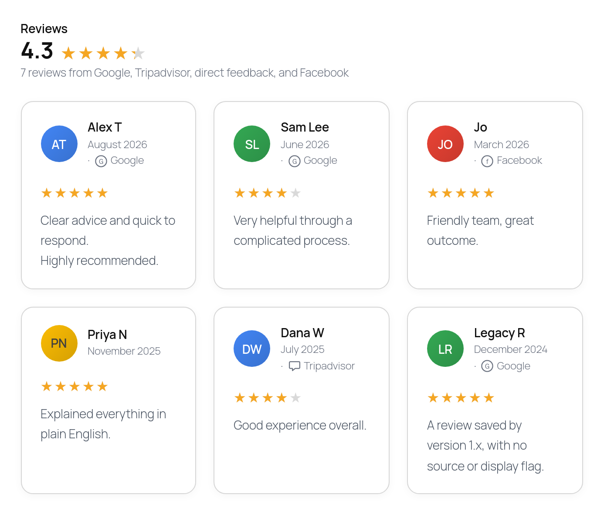
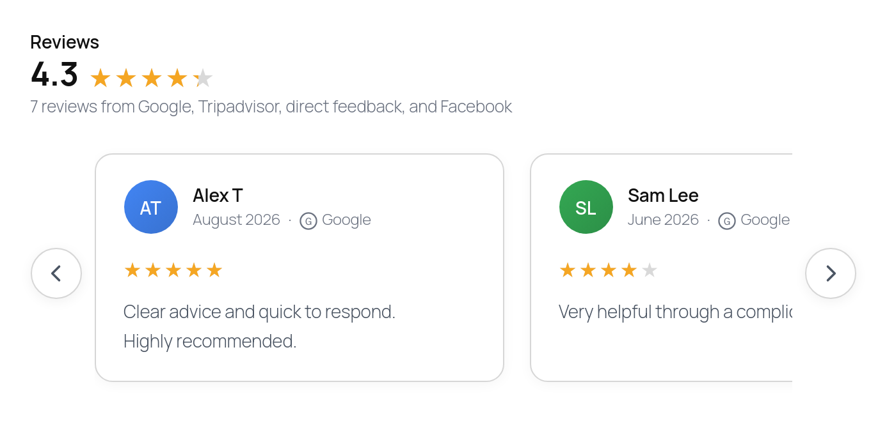
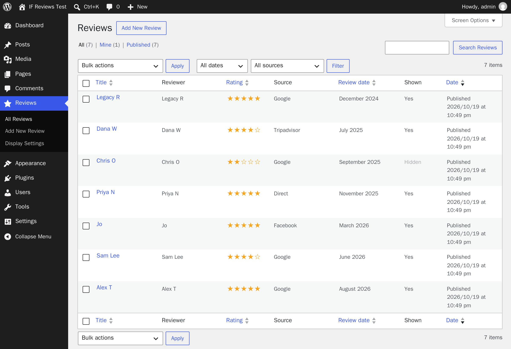

# WP Reviews


A small WordPress plugin for showing the reviews your business has already received, on your own site, under your own control.

Add each review in wp-admin, by hand, from a CSV file or with the optional Google import: reviewer name, date, star rating, review text and where it was left (Google, Facebook, Trustpilot, Yelp, ProductReview.com.au, directly to you, or anywhere else). The `[if_reviews]` shortcode or the Reviews block shows them as a card grid, a list or a carousel, with the overall rating, review count and a plain statement of where the reviews came from.

**Your reviews live on your own site.** By default the plugin contacts no review platform: you type, paste or import each review, so it keeps working if a platform changes its API, pricing or terms. The one exception is the optional Google Business Profile import, which stays off until you connect it.

- Latest release and download: [Releases](https://github.com/yog18r/Wordpress-Reviews/releases)
- WordPress-style readme with the full FAQ and changelog: [readme.txt](readme.txt)



*The default grid. The header is calculated from every review, including hidden ones, and names each source the reviews came from.*



*`[if_reviews layout="carousel"]` for sites with many reviews.*



*The Reviews screen in wp-admin: sortable rating and date, a source filter, and bulk actions to re-tag or hide many reviews at once.*

## Use it honestly

The plugin is arranged so the easy path is also the truthful one.

- **Add every review you receive, including the unfavourable ones.** The header's average and count are calculated from all published reviews, not just the visible ones.
- **Hide, don't delete.** Untick "Display this review on the website" to keep a review off the cards. It stays in WordPress and still counts toward the average and the count.
- **Label sources accurately.** The header says "Google Reviews" only when every review in that shortcode is marked as a Google review. Otherwise it lists the mix: "24 reviews from Google, Facebook, and direct feedback".
- **Copy, don't edit.** Paste the review text as written.
- **No review schema, on purpose.** The plugin outputs plain HTML with no `Review` or `AggregateRating` structured data. Google does not show stars for reviews a business publishes about itself, so the markup would gain nothing and risks a penalty. The stars beside your business in search come from your Google Business Profile.

Consumer protection law in many countries (the Australian Consumer Law, the US FTC rule on consumer reviews, the UK DMCC Act, among others) treats fabricated, edited or selectively presented reviews as misleading. The plugin gives you the means to present reviews properly. Using it truthfully is your responsibility.

## Features

- **Reviews** screen in wp-admin with name, date, rating, source, text and a show/hide toggle. Sortable columns, a source filter and bulk actions for sites with many reviews.
- **Per-review source badges.** Built in: Google, Facebook, Trustpilot, Yelp, ProductReview.com.au, Direct, Other (custom label). Add more with a filter.
- **Honest summary header** with fractionally filled stars and an automatic description of the sources, or your own title.
- **Three layouts**: grid (1 to 4 columns), list, carousel. Limit the count with a "Show more" button, cut long reviews with "Read more". Sort newest, oldest, highest or random.
- **CSV import and export** with a template, fraction-to-stars conversion (8/10 → 4 stars) and duplicate skipping.
- **Optional Google Business Profile import** through your own Google Cloud project: every review from one location, matched against reviews you had already entered, kept current when reviewers edit, flagged when Google removes one. Off until connected.
- **A block for the block editor** with a live preview, plus the shortcode for widgets and templates.
- **Optional link to the original review** on each card, and an opt-in setting to automatically hide low ratings from the cards while still counting them in the header.
- **"Leave us a review" buttons** to your review page on each platform, with guidance on finding the direct links. Off by default; also available on their own via `[if_reviews_buttons]`.
- **Categories** to show the right reviews on each page, **pinned reviews**, **numbered pagination** and **carousel autoplay** for large sets.
- **Featured Review** and **Rating Badge** blocks and shortcodes for landing pages, headers and footers.
- **Styling from a settings screen**: colours, corner radius and a cycling avatar palette with automatic contrast.
- **Lightweight**: one small stylesheet and one small script, loaded only where the shortcode renders. No jQuery, and no external requests apart from the update check, unless you connect Google.
- **Automatic updates** from this repository's releases.
- Translation-ready and accessible.

## Installation

1. Download `if-reviews.zip` from the [latest release](https://github.com/yog18r/Wordpress-Reviews/releases/latest).
2. In wp-admin: Plugins → Add New Plugin → Upload Plugin → choose the zip → Activate.
3. Reviews → Add New to enter your first review.
4. Reviews → Display Settings to set colours and layout defaults.
5. Put `[if_reviews]` on a page.

Requires WordPress 6.3+ and PHP 7.4+.

## Shortcode

| Example | Result |
| --- | --- |
| `[if_reviews]` | All visible reviews with the defaults from Display Settings |
| `[if_reviews layout="carousel"]` | `grid` (default), `list` or `carousel` |
| `[if_reviews columns="2"]` | Up to two grid columns (1–4); collapses on small screens |
| `[if_reviews limit="6"]` | Six reviews plus a "Show more" button |
| `[if_reviews source="google"]` | One source only; the header describes that source alone |
| `[if_review id="42"]` | One review as a featured quote |
| `[if_reviews_rating]` | Inline "★★★★★ 4.8 from 120 reviews" badge |

Full list of options: the Shortcode section of [readme.txt](readme.txt), or the bottom of Reviews → Display Settings.

In the block editor, use the **Reviews**, **Featured Review** and **Rating Badge** blocks instead. The Reviews block's sidebar has the same options as the shortcode; anything left at "Default" follows Display Settings.

## Importing reviews

Reviews → Import / Export. Download the template, fill in one review per row and upload it. Only `reviewer_name` and `rating` are required; `review_date`, `review_text`, `source`, `source_label`, `review_url`, `categories`, `pinned`, `display` and `status` are optional. Rows that match an existing review (same name, date and text) are skipped, so a corrected file can be re-imported. Export gives you the same format back as a backup.

## Google Business Profile import

Reviews → Google import. Optional, off by default, and built on a Google Cloud project you own: the plugin contacts Google only once you connect it, and nothing passes through a third-party server.

Why a Cloud project? Google's Business Profile API returns every review but is open only to projects Google has approved, so there is one-off setup: a verified profile at least 60 days old that lists your site, a Cloud project, Google's approval (days to weeks), three APIs, a consent screen and an OAuth client. The Google import page walks through each step; the FAQ in [readme.txt](readme.txt) explains why other plugins skip this.

To keep the connection from expiring, a Workspace account sets the consent screen audience to Internal; a personal Google account chooses External and clicks "Publish app" (Google ends a Testing app's connection after 7 days). If a Workspace administrator restricts third-party apps, they mark the app Trusted in the Admin console; the page gives the exact steps.

How the sync behaves:

- The first sync is a preview. Existing reviews with the source Google are matched by reviewer name, rating and text; you confirm or change each match, and matched reviews are linked rather than imported again.
- Every linked or imported review stores Google's review ID, so later edits never create a copy. Later syncs import new reviews and auto-link close matches; use Preview sync to check first.
- Linked reviews take Google's reviewer name, rating, text and date, and follow later edits. Hidden, pinned and category settings are never touched.
- A review that disappears from Google is kept and marked "No longer on Google" in the Reviews list.
- If the connection stops working, the page shows a Reconnect button.
- The Client ID, Client Secret, token and account identifiers are stored encrypted with libsodium, keyed from the site's wp-config.php security keys (or `IF_REVIEWS_ENCRYPTION_KEY`). Encryption fails closed, connecting is blocked while the key would live in the database, and values move to a new key automatically when one is added. `IF_REVIEWS_GOOGLE_CLIENT_ID` and `IF_REVIEWS_GOOGLE_CLIENT_SECRET` in wp-config.php keep the credentials out of the database entirely.
- Daily sync is a checkbox; it runs about once a day after you have applied a first preview.

## Updates

The plugin bundles [Plugin Update Checker](https://github.com/YahnisElsts/plugin-update-checker) (MIT) and watches this repository's releases. New versions show up on the Plugins screen like any other plugin. To opt out on a site:

```php
add_filter( 'if_reviews_update_checker_enabled', '__return_false' );
```

## For developers

Filters:

| Filter | Purpose |
| --- | --- |
| `if_reviews_sources` | Add or rename sources (`label`, optional `description`, optional inline SVG `icon`) |
| `if_reviews_source_has_badge` | Decide which sources show a badge on cards (default: all except `direct`) |
| `if_reviews_reviews` | Alter the loaded reviews before stats and display |
| `if_reviews_date_format` | PHP date format for review dates (default `F Y`) |
| `if_reviews_show_more_label` | Label of the "Show more" button |
| `if_reviews_cta_buttons` | Alter the "Leave us a review" buttons |
| `if_reviews_cta_help` | The "Where do I find this link?" help for each platform |
| `if_reviews_google_fetched_reviews` | Alter reviews fetched from Google before they are matched |
| `if_reviews_update_checker_enabled` | Disable GitHub update checks |

Data model: post type `if_review`; taxonomy `if_review_category`; meta `_if_reviewer_name`, `_if_review_date` (Y-m-d), `_if_rating` (1–5), `_if_review_text`, `_if_source`, `_if_source_label`, `_if_review_url`, `_if_pinned`, `_if_display_on_website` (`'1'`/`'0'`), plus `_if_google_review_id`, `_if_google_updated` and `_if_google_missing` on synced reviews; options `if_reviews_options` and `if_reviews_google`. Reviews can be added and edited by Editors and Administrators; settings, import and Google need `manage_options`.

Layout of the repository:

```
if-reviews.php          plugin bootstrap and constants
includes/crypto.php     encryption for private stored values (libsodium)
includes/helpers.php    options, sanitising, formatting helpers
includes/sources.php    source registry and badge icons
includes/post-type.php  the if_review post type and its admin list
includes/meta-box.php   the Review Details meta box and save handler
includes/settings.php   Reviews → Display Settings
includes/shortcode.php  [if_reviews]: data, header, layouts, pagination
includes/snippets.php   [if_review] featured quote and [if_reviews_rating] badge
includes/cta.php        "Leave us a review" buttons and [if_reviews_buttons]
includes/block.php      the three blocks (rendered through the shortcodes)
includes/import-export.php  Reviews → Import / Export (CSV)
includes/google-import.php  Reviews → Google import (OAuth, matching, sync)
includes/enqueue.php    front-end assets and settings-driven CSS
includes/updater.php    GitHub release update checks
blocks/                 reviews, featured, rating: block.json + block.js (plain JS, no build step)
assets/                 reviews.css, reviews.js (no dependencies)
vendor/                 Plugin Update Checker (MIT)
uninstall.php           cleanup on delete
tests/                  regression tests: run.sh starts WordPress in Docker and runs cases.php
readme.txt              WordPress.org-format readme, FAQ and changelog
```

### Releasing a new version

1. Bump the version: the `Version:` header and `IF_REVIEWS_VERSION` in `if-reviews.php`, `Stable tag:` in `readme.txt`, and the `version` in each `blocks/*/block.json` and `block.asset.php`. Add a changelog entry under `== Changelog ==`.
2. Commit, then tag and push:

   ```bash
   git tag -a vX.Y.Z -m "WP Reviews X.Y.Z" && git push origin main --tags
   ```

3. The [release workflow](.github/workflows/release.yml) checks the three version numbers match the tag, lints the PHP, builds `if-reviews.zip` (everything except the files in `.distignore`) and publishes a GitHub Release with that version's changelog as the notes. Sites running the plugin see the update within twelve hours, or immediately after "Check again" on the Updates screen.

Every push also runs `php -l` on PHP 7.4, 8.1 and 8.3, and the regression tests.

### Tests

```bash
bash tests/run.sh
```

Needs Docker. It starts MariaDB and WordPress, mounts the plugin with a mock of Google's API, runs `tests/cases.php` phase by phase with WP-CLI (including phases with changed wp-config.php keys), uninstalls the plugin, and removes everything. Run it before tagging a release.

## Contributing

Issues and pull requests are welcome. Keep the plugin small: no build step, no framework, no network calls beyond the update check. Anything new that the plugin stores and does not display publicly must go through `if_reviews_encrypt()` / `if_reviews_decrypt()`. Add a test to `tests/cases.php` for anything security-related. If you add a source, use a simple single-colour SVG mark rather than a platform's official logo.

## Licence

GPL-2.0-or-later. See [LICENSE](LICENSE).

The bundled Plugin Update Checker library is © Jānis Elsts and released under the MIT licence; see [vendor/plugin-update-checker/license.txt](vendor/plugin-update-checker/license.txt).
